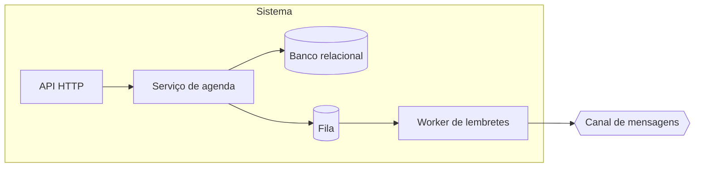

# HLD: Agendamento de barbearias

Versão: 0.1.0
Data: 2026-10-23
Responsável: Equipe
PRD: docs/product/prd.md versão 0.2.0

---

## Objetivo técnico

Atender RF-001 a RF-005 com um serviço único e um worker de lembretes.

Problemas técnicos endereçados
- Agenda manual sem rastro

Sistemas e módulos conectados
- Canal de mensagens: envia lembretes

---

## Arquitetura geral

Monólito modular com worker separado.

Ambiente de implantação
- cloud: contêineres

Tecnologias principais

| Tecnologia | Papel | Decisão |
| --- | --- | --- |
| PostgreSQL | banco relacional | ADR-0005 |
| Kafka | fila de lembretes | ADR-0007 |
| Redis | cache de agenda | ADR-0004 (proposed) |
| Node.js | runtime | pendente de ADR |

Padrões adotados
- camadas: simples para o time

---

## Componentes e responsabilidades

| Componente | Responsabilidades | Dependências |
| --- | --- | --- |
| API HTTP | recebe requisições e autentica | Serviço de agenda |
| Serviço de agenda | regras de marcação, persiste | Banco relacional, Fila |
| Worker de lembretes | consome fila e envia mensagens | Fila, Canal de mensagens |
| Banco relacional | persiste | nenhuma |
| Fila | desacopla envio | nenhuma |

---

## Fluxos de requisição e de dados

### Fluxo: Cliente agenda (RF-002)
- Cliente envia pedido para API HTTP
- API HTTP valida e chama Serviço de agenda
- Serviço de agenda grava no Banco relacional
- Serviço de agenda publica lembrete na Fila

### Fluxo: Lembrete (RF-003)
- Worker de lembretes lê a Fila
- Worker de lembretes envia pelo Canal de mensagens
- Worker de lembretes registra envio no Banco relacional

Fluxo de dados
- marcação: API HTTP → Serviço de agenda → Banco relacional

Persistência e replicação
- Banco relacional com réplica; consistência forte

---

## Modelo de dados (alto nível)

Entidades principais
- Barbearia: dona dos serviços
- Serviço: nome, duração, preço
- Barbeiro: horário de trabalho
- Marcação: serviço, barbeiro, cliente, horário

Relações
- Barbearia 1:N Serviço: serviço pertence a uma barbearia

Fonte de verdade
- Marcação: Banco relacional

Sincronização e cache
- agenda do dia em cache por 1 minuto

Versionamento e retenção
- marcações por 2 anos

---

## Interfaces públicas

| Nome | Tipo | Protocolo | Exposição | SLA e limites |
| --- | --- | --- | --- | --- |
| API pública | API | REST/JSON | externa | p95 300 ms |
| Fila de lembretes | fila | AMQP | interna | processado em até 1 minuto |

---

## Escalabilidade e disponibilidade

Abordagem geral
- réplicas horizontais da API

Técnicas aplicadas
- cache da agenda do dia

Metas
- Disponibilidade: 99.5 por cento mensal
- Recuperação: RTO 1 hora, RPO 15 minutos
- Capacidade: 10 vezes o volume atual

---

## Segurança

Autenticação
- e-mail e senha para dono; token por link para cliente

Autorização
- papel dono e barbeiro

Proteção de dados
- TLS em trânsito; dados em repouso criptografados

Gestão de segredos
- cofre gerenciado

---

## Observabilidade

Logs
- JSON com id de correlação

Métricas
- erro e latência p95 por interface

Tracing
- amostragem de 10 por cento

Dashboards e alertas
- alerta com taxa de erro acima de 1 por cento por 5 minutos

---

## Riscos arquiteturais e mitigação

### Canal de mensagens indisponível
- **Probabilidade:** media
- **Impacto:** lembretes não saem
- **Mitigação:**
  - fila com retentativa
- **Plano de contingência:** envio manual pelo dono

---

## Rastreabilidade com o PRD

| Requisito | Componentes | Interfaces | Fluxo |
| --- | --- | --- | --- |
| RF-001 | API HTTP, Serviço de agenda | API pública | Cliente agenda |
| RF-002 | API HTTP, Serviço de agenda | API pública | Cliente agenda |
| RF-003 | Worker de lembretes | Fila de lembretes | Lembrete |
| RF-004 | API HTTP, Serviço de agenda | API pública | Cliente agenda |
| RF-005 | API HTTP, Serviço de agenda | API pública | Cliente agenda |

Requisitos não funcionais do PRD
- Performance: Interfaces públicas, p95 300 ms

---

## ADRs e próximos passos

ADRs associados
- ADR-0007 Usar Kafka como plataforma de streaming: fila de lembretes
- ADR-0005 Usar PostgreSQL como banco relacional: banco
- ADR-0006 Usar OIDC para autenticação: fora do escopo, cliente entra por token

Decisões pendentes de ADR
- Node.js: runtime
- Redis: em discussão no ADR-0004

Próximos passos
- escrever os ADRs pendentes
