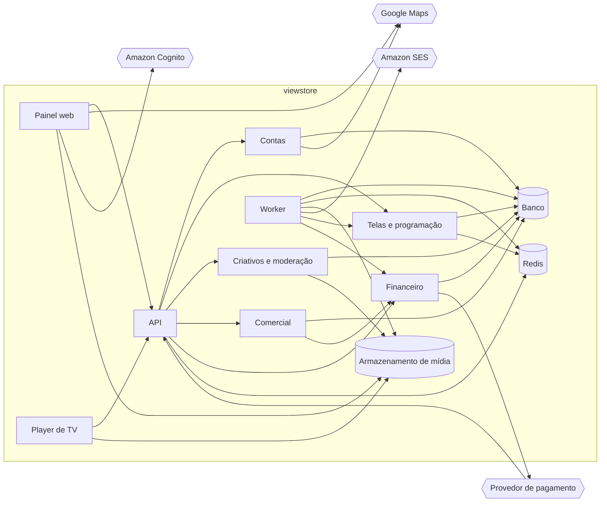

# HLD: viewstore

Versão: 0.2.0
Data: 2026-10-24
Responsável: Maicon Souza (hipótese)
PRD: docs/product/prd.md versão 0.1.2

---

## Objetivo técnico

O viewstore é um backend único com painel web e mapa público, mais um player na TV que baixa a programação e os criativos, reproduz por até 72 horas sem internet e devolve os registros de exibição. O backend concentra contas, telas, criativos, venda de espaços e dinheiro (RF-001 a RF-011, RF-017), e o player executa a reprodução e a comprovação (RF-012). Pagamentos, repasse e painéis (RF-013 a RF-016) leem do mesmo banco transacional, para que dinheiro e exibição batam por construção.

Problemas técnicos endereçados
- TV offline por até 72 horas: o player precisa de mídia e registros em armazenamento local e reenvio idempotente ao reconectar (RF-012).
- Consistência financeira: venda de espaço e cobrança acontecem juntas ou não acontecem; saldo e crédito nunca negativos; repasse mais comissão igual ao valor entregue.
- Propagação em até 5 minutos: programação publicada ou campanha aprovada precisa estar na TV em até 5 minutos (RF-005).
- Heterogeneidade de TVs: Smart TVs Tizen e Android TV rodam o app; TV LG (webOS) e TV comum recebem um box Android na entrada HDMI, porque o webOS não deixa app web baixar mídia (ADR-0005).

Sistemas e módulos conectados
- Asaas, provedor de pagamento (DEP-1, ADR-0007): o viewstore envia cobranças avulsas, assinaturas recorrentes e saques por Pix; o provedor devolve confirmações e recusas por webhook.
- Google Maps Platform (DEP-2): o viewstore envia o endereço no cadastro e recebe coordenada e `place_id`; o exibidor confirma o ponto; o navegador carrega o mapa direto do Google.
- Amazon SES: só saída, e-mails de moderação, inadimplência, renovação e saque.
- Amazon Cognito: o painel autentica pessoas no Cognito e a API valida o token emitido.

---

## Arquitetura geral

Monólito modular em TypeScript com NestJS (ADR-0002), com módulos por domínio e dois processos da mesma base de código: a API HTTP e o Worker de filas e agendamentos. Um único PostgreSQL com PostGIS (ADR-0003) é a fonte de verdade de tudo, o que permite resolver as regras de dinheiro em transação e constraint em vez de transação distribuída. O painel é uma SPA estática na CDN (ADR-0004) e o player é a mesma tecnologia web empacotada como app por plataforma de TV, servido por manifesto versionado e mídia na CDN, o que tira o tráfego de vídeo da API e deixa a TV independente da plataforma por 72 horas.

Ambiente de implantação
- cloud: AWS na região sa-east-1 (São Paulo). API e Worker em contêineres no ECS Fargate, API atrás de load balancer; PostgreSQL no RDS; Redis no ElastiCache; criativos no S3 entregues pela CloudFront, que também serve o painel. Ambientes de homologação e produção em contas AWS separadas, com a mesma topologia em tamanho menor na homologação.
- TVs: app do player instalado na Smart TV Tizen ou Android TV, ou no box Android na HDMI para TV LG e TV comum, falando com a API e a CDN pela internet do estabelecimento.

Tecnologias principais

| Tecnologia | Papel | Decisão |
| --- | --- | --- |
| TypeScript com NestJS | Base de código da API e do Worker, guards de permissão, OpenAPI | ADR-0002 |
| PostgreSQL com PostGIS | Banco único, transações de dinheiro, busca geográfica do mapa | ADR-0003 |
| React com React Router (SPA) | Painel web estático na CDN | ADR-0004 |
| AWS (ECS Fargate, RDS, ElastiCache, S3, CloudFront, KMS, Secrets Manager) | Plataforma de execução, dados e entrega de mídia | ADR-0006 |
| Player web empacotado (Tizen, Android TV) e box Android na HDMI | App de reprodução nas TVs com armazenamento local | ADR-0005 |
| Asaas | Cobrança avulsa, assinatura recorrente, saque por Pix | ADR-0007 |
| Redis com BullMQ | Filas, agendamentos e cache do manifesto | ADR-0008 |
| Amazon Cognito | Autenticação de pessoas por OIDC, MFA do operador | ADR-0009 |
| Google Maps Platform | Geocodificação no cadastro e mapa público | ADR-0010 |
| Amazon SES | E-mail transacional | ADR-0011 |
| CloudWatch e X-Ray com OpenTelemetry | Logs, métricas, alarmes e tracing | ADR-0012 |

Padrões adotados
- Monólito modular: um deploy, módulos com fronteira de código e donos das próprias tabelas, para extrair serviço depois sem reescrever.
- Transação única com outbox: venda, cobrança e lançamento numa transação do PostgreSQL; efeitos externos (e-mail, manifesto, filas) saem por uma tabela outbox lida pelo Worker.
- Livro-razão de lançamentos: todo movimento de dinheiro é um lançamento imutável ligado a campanha, tela e conta; saldo e crédito são somas, protegidos por constraint.
- Idempotência: webhook de pagamento e lote de exibições carregam chave única; reprocessar não duplica.
- REST com OpenAPI versionado: contrato gerado pelo NestJS, versão maior na URL (`/v1`).

---

## Componentes e responsabilidades

| Componente | Responsabilidades | Dependências |
| --- | --- | --- |
| Painel web | SPA dos papéis exibidor, anunciante e operador e mapa público sem login. Envia criativos direto ao S3 por URL assinada. | API, Amazon Cognito, Google Maps, Armazenamento de mídia |
| Player de TV | App web em TypeScript empacotado para Tizen e Android TV (o box usa o build Android TV). Vínculo por código, polling de versão a cada 1 minuto, cache local de mídia e registros, reprodução na orientação da tela, envio de exibições em lotes. | API, Armazenamento de mídia |
| API | Borda HTTP do painel, do player e do webhook: valida token, aplica autorização por papel e posse, rate limit e OpenAPI. Não guarda estado próprio. | Contas, Telas e programação, Criativos e moderação, Comercial, Financeiro, Redis |
| Contas | Conta com papéis, estabelecimentos com ponto confirmado pelo exibidor e `place_id` do Google, dados de recebimento cifrados, auditoria de alterações sensíveis. Persiste. | Banco, Google Maps |
| Telas e programação | Telas, vínculo e token de dispositivo, programação privada, manifesto versionado por tela, heartbeat e status online, ingestão e deduplicação de exibições. Persiste e cacheia a versão do manifesto. | Banco, Redis |
| Criativos e moderação | Criativos com versões por orientação, URLs assinadas de upload, fila de moderação, ramo do anunciante, criativos globais. Persiste. | Banco, Armazenamento de mídia |
| Comercial | Preço e ciclo das telas públicas, busca do mapa por PostGIS, disponibilidade por semana, reserva de espaço, campanhas diretas e pacotes de rede. Orquestra a contratação. | Banco, Financeiro |
| Financeiro | Livro-razão, cobranças e assinaturas no provedor, crédito e estorno, fechamento mensal, saldo e saque, planos e parâmetros comerciais. Persiste o dinheiro. | Banco, Provedor de pagamento |
| Worker | Consome outbox e filas: gera manifestos, valida e transcodifica vídeo com ffmpeg, expira reservas, renova pacotes e assinaturas, roda o fechamento mensal, renova visões dos painéis, envia e-mail. | Banco, Redis, Armazenamento de mídia, Amazon SES, Telas e programação, Financeiro |
| Banco | PostgreSQL com PostGIS no RDS: fonte de verdade de todas as entidades, outbox e visões materializadas. | nenhuma |
| Redis | ElastiCache: filas BullMQ, versão do manifesto por tela, contadores de rate limit. Recuperável a partir da outbox. | nenhuma |
| Armazenamento de mídia | S3 com criativos originais e transcodificados e manifestos por versão, entregues pela CloudFront com URL imutável. | nenhuma |

---

## Fluxos de requisição e de dados

### Fluxo: contratação de anúncio direto (RF-010, RF-004)
- Anunciante escolhe telas, semanas, espaços e criativo no Painel web, que envia o pedido à API.
- Comercial confere orientação e disponibilidade e grava a reserva dos espaços com prazo de 15 minutos; Financeiro cria a cobrança no Provedor de pagamento, na mesma transação lógica (reserva gravada antes, cobrança ligada a ela).
- Pagamento só com crédito: Financeiro lança o débito do crédito e Comercial converte a reserva em venda na mesma transação.
- Provedor de pagamento chama o webhook; a API confere o token do cabeçalho `asaas-access-token`, consulta a cobrança na API do Asaas para confirmar o status e enfileira; o Worker, de forma idempotente, converte a reserva em venda e lança no livro-razão numa transação.
- Reserva expirada ou pagamento recusado: o Worker libera os espaços e cancela a cobrança.
- Criativos e moderação aprova o criativo; a aprovação grava evento na outbox e a campanha entra no manifesto das telas contratadas.

### Fluxo: programação chega à TV (RF-005, RF-006, RF-012)
- Publicação de programação, aprovação de criativo, troca de plano ou virada de semana grava um evento na outbox.
- Worker calcula o ciclo de cada tela afetada (vendidos, rede, livres, brand do freemium), grava o manifesto versionado no Armazenamento de mídia e a nova versão no Banco e no Redis.
- Player de TV consulta a versão a cada 1 minuto; a API responde do Redis.
- Versão nova: o Player baixa o manifesto e os criativos que faltam pela CloudFront, valida e troca a programação no fim do criativo em exibição.
- Efeito observável: TV reproduz a nova programação em até 5 minutos da publicação.

### Fluxo: registros de exibição offline (RF-012, RF-013)
- Player de TV grava cada exibição no armazenamento do app com id único, tela, criativo, hora local e desvio de relógio.
- A cada polling com rede, envia lotes de até 1.000 exibições à API.
- Telas e programação deduplica pelo id, corrige a hora pelo desvio e grava na tabela particionada por mês.
- Sem internet, o Player segue a última programação e acumula registros por até 72 horas; ao reconectar, envia os lotes em ordem.
- Efeito observável: exibições aparecem na comprovação do anunciante na próxima renovação das visões do painel.

### Fluxo: fechamento mensal e saque (RF-014, RF-015)
- No primeiro dia do mês o Worker inicia o fechamento do mês anterior (hipótese).
- Soma o anúncio direto entregue por tela e rateia o valor dos pacotes de rede entre telas pelas exibições registradas.
- Financeiro lança 30 por cento de comissão e 70 por cento no saldo de cada exibidor, numa transação (onde esse saldo fica depende da decisão de custódia pendente de ADR); a checagem de repasse mais comissão igual ao entregue falha o fechamento se não bater.
- Exibidor pede saque no Painel web; Financeiro debita o saldo e envia a transferência Pix ao Provedor de pagamento.
- Webhook confirma ou recusa; recusa por dados inválidos devolve o valor ao saldo com aviso por e-mail.

Fluxo de dados
- Painel web → API → módulos → Banco: cadastros, preços, contratações e saques.
- Painel web → Armazenamento de mídia (URL assinada) → Worker (ffmpeg) → Armazenamento de mídia: criativo original vira versão compatível com as TVs.
- Banco (outbox) → Worker → Armazenamento de mídia e Redis: eventos viram manifesto por tela e nova versão.
- Player de TV → API → Telas e programação → Banco: lotes de exibição.
- Financeiro ↔ Provedor de pagamento: cobranças e saques saem; confirmações voltam por webhook.

Persistência e replicação
- Todo dado de negócio grava no PostgreSQL com consistência forte; dinheiro, venda e reserva mudam na mesma transação.
- Manifesto e versão replicam para Armazenamento de mídia e Redis com consistência eventual, janela de até 5 minutos.
- Agregados dos painéis em visões materializadas renovadas a cada 5 minutos; disponibilidade do mapa lida na hora.
- Banco em instância única no RDS com backup contínuo; sem réplica de leitura.

---

## Modelo de dados (alto nível)

Entidades principais
- Conta: pessoa ou empresa com CPF ou CNPJ único, papéis exibidor e anunciante, dados de recebimento cifrados.
- Estabelecimento: nome, ramo, endereço, `place_id` do Google e ponto geográfico (PostGIS) confirmado ou posicionado pelo exibidor; a coordenada crua da Geocoding API não é guardada, porque os termos limitam o cache dela a 30 dias (ADR-0010).
- Tela: modo (pública ou privada), orientação, ciclo de espaços, preço por espaço por semana, token de dispositivo, último contato.
- Criativo: autor, versões por orientação, duração, status de moderação, ramo do anunciante.
- Plano e Assinatura: limites, preço, periodicidade, brand; assinatura com período vigente e estado de inadimplência.
- Campanha: anúncio direto ou pacote de rede, criativo, período, renovação automática.
- Venda de espaço: tela, semana, quantidade de espaços, estado (reservada, vendida, liberada), prazo da reserva.
- Manifesto: versão da programação de uma tela, com a lista ordenada de criativos e o endereço na CDN.
- Exibição: tela, criativo, campanha, data e hora corrigidas, id único do player.
- Lançamento: movimento imutável de dinheiro (cobrança, crédito, estorno, comissão, repasse, saque) ligado a conta, campanha e tela.

Relações
- Conta 1:N Estabelecimento 1:N Tela: o exibidor só gerencia telas dos próprios estabelecimentos.
- Tela 1:N Venda de espaço N:1 Campanha: a soma dos espaços vendidos por tela e semana nunca passa o ciclo (constraint).
- Campanha N:1 Criativo: só criativo aprovado e com a orientação da tela entra no manifesto.
- Tela 1:N Manifesto: só a versão mais recente vale; as anteriores ficam para auditoria.
- Tela 1:N Exibição: base da comprovação e do rateio da rede.
- Conta 1:N Lançamento: saldo e crédito são a soma dos lançamentos e nunca ficam negativos.

Fonte de verdade
- Todas as entidades: Banco (PostgreSQL), cada uma possuída pelo módulo que a escreve.
- Estado de cobranças e saques: Provedor de pagamento, espelhado no Banco por webhook e conciliado.
- Arquivos de criativo e de manifesto: Armazenamento de mídia.

Sincronização e cache
- Versão do manifesto por tela no Redis, atualizada pelo Worker a cada nova versão; sem TTL, invalida pela versão nova.
- Manifesto e criativos na CloudFront com URL imutável por versão; não há invalidação de CDN.
- Resultado da busca do mapa em cache de 1 minuto.
- No Player, mídia e manifesto no armazenamento do app até a próxima versão.

Versionamento e retenção
- Contratos REST versionados por versão maior na URL; manifesto com versão numérica por tela.
- Exibições no detalhe por 13 meses, depois só totais por tela, criativo e dia; partições mensais antigas são removidas.
- Lançamentos financeiros por 5 anos, prazo a confirmar com o contador (DEP-3).
- Dados pessoais de conta encerrada anonimizados em 30 dias, mantendo o vínculo dos lançamentos.

---

## Interfaces públicas

| Nome | Tipo | Protocolo | Exposição | SLA e limites |
| --- | --- | --- | --- | --- |
| API do painel | API | REST/JSON sobre HTTPS, `/v1` | externa | p95 500 ms; 20 req/s por conta; 5 req/s por IP anônimo no mapa |
| API do player | API | REST/JSON sobre HTTPS, `/v1` | externa | consulta de versão p95 200 ms; lote de até 1.000 exibições aceito em p95 2 s; 1 consulta por minuto por tela |
| Webhook de pagamento | webhook | HTTPS/JSON com token estático no cabeçalho `asaas-access-token` | externa | resposta em até 2 s; entrega ao menos uma vez, processamento idempotente em até 1 minuto |
| Manifesto e mídia na CDN | arquivo | HTTPS (CloudFront) | externa | URL imutável por versão; manifesto e mídia nova baixados dentro da janela de 5 minutos da meta de propagação |
| Upload de criativo | arquivo | HTTPS para S3 com URL assinada | externa | URL válida por 15 minutos; tamanho máximo pelo plano |
| Filas do Worker | fila | BullMQ sobre Redis | interna | evento processado em até 1 minuto; 5 retentativas e fila de mortos |

---

## Escalabilidade e disponibilidade

Abordagem geral
- Cresce por réplicas horizontais da API e do Worker sobre um banco único, e sobrevive a falha da plataforma porque as TVs seguem 72 horas com a programação baixada.

Técnicas aplicadas
- Autoscaling no Fargate: API de 2 a 6 réplicas por CPU acima de 60 por cento; Worker de 1 a 4 réplicas pelo tamanho da fila.
- Load balancer na frente da API com health check.
- Cache da versão do manifesto no Redis e mídia na CloudFront, para que o polling e o vídeo não toquem o banco.
- Tabela de exibições particionada por mês.
- Rate limit na API por conta e por IP.
- Redis em instância única: se cair, o polling consulta o banco e o Worker regera as filas a partir da outbox.
- Banco em instância única com janela de manutenção de madrugada; migração para Multi-AZ ao abrir a venda na região ou depois de um mês abaixo da meta de disponibilidade.

Metas
- Disponibilidade: 99,5 por cento mensal para painel, mapa e contratação (do PRD); TVs reproduzem por 72 horas com a plataforma fora do ar.
- Recuperação: RTO 1 hora, RPO 5 minutos, por backup contínuo do RDS com restauração pontual.
- Capacidade: 1.000 telas, 10 vezes a meta de 6 meses, só com réplicas; cerca de 17 consultas de versão por segundo e 1,5 milhão de exibições por dia, supondo 1 exibição por minuto por tela em 24 horas (hipótese).

---

## Segurança

Autenticação
- Pessoas entram pelo Amazon Cognito (OIDC); a API valida o JWT em toda rota autenticada. Operador com MFA obrigatório.
- TV usa token de dispositivo opaco emitido no vínculo; o código de vínculo vale 10 minutos; o token é revogável pelo exibidor ou pelo operador.
- Webhook de pagamento só é aceito com o token do cabeçalho `asaas-access-token` igual ao do Secrets Manager; como o token é estático e não assina o corpo, o status da cobrança é sempre reconsultado na API do Asaas antes de mudar venda ou saldo.
- Mapa público é a única leitura anônima, com rate limit por IP.

Autorização
- Guard do NestJS checa papel (exibidor, anunciante, operador) e posse do recurso em toda rota: exibidor só os próprios estabelecimentos, telas e criativos; anunciante só as próprias campanhas; operador modera e configura.
- Token de tela só lê a própria programação e só envia exibições da própria tela.
- Alterações de preço, plano, piso e dados de recebimento gravam autor, valor anterior e horário numa tabela de auditoria imutável.

Proteção de dados
- TLS em todo tráfego; disco criptografado no RDS e no S3.
- Chave Pix e conta bancária cifradas na aplicação com chave do KMS e mascaradas no painel; CPF e CNPJ com criptografia de disco.
- Nenhum dado pessoal em log.
- Dados pessoais tratados conforme a LGPD, com anonimização em 30 dias após o encerramento da conta.

Gestão de segredos
- Segredos (chaves do provedor de pagamento e do Google Maps, credenciais do banco) no Secrets Manager, com rotação a cada 90 dias e acesso por papel IAM de cada serviço.

---

## Observabilidade

Logs
- JSON estruturado no CloudWatch com id de correlação ponta a ponta, componente, conta e tela; nenhum dado pessoal; retenção de 30 dias.

Métricas
- Por API: taxa de erro 5xx e latência p95. Por fila: tamanho e idade do evento mais antigo. Por TV: último contato, versão do manifesto, versão do app e espaço livre, vindos do heartbeat no polling.

Tracing
- OpenTelemetry na API e no Worker, exportado para o X-Ray; contexto propagado pela outbox e pelas filas; amostragem de 10 por cento e 100 por cento em erro.

Dashboards e alertas
- Alertas só de disponibilidade: API fora do ar pelo health check do load balancer e fila parada sem consumo.
- Tela sem contato há 5 minutos é marcada offline; offline há 24 horas entra na lista do operador (RF-016), sem alerta.
- A conferência de repasse mais comissão igual ao entregue é checagem do próprio fechamento mensal, que falha se não bater.

---

## Riscos arquiteturais e mitigação

### App empacotado não funciona em parte das TVs
- **Probabilidade:** alta
- **Impacto:** tela não reproduz, não aceita o codec ou não guarda 72 horas de mídia, gerando crédito ao anunciante e exibidor insatisfeito.
- **Mitigação:**
  - Prova de conceito em TV Samsung (Tizen), TV Android e no box Android antes do piloto, com teste de 72 horas offline e vídeo.
  - Lista de modelos homologados publicada ao exibidor.
  - Espaço livre e versão do app no heartbeat para agir antes da falha.
- **Plano de contingência:** box Android homologado na entrada HDMI rodando o build Android TV, que já é o caminho padrão da TV LG e da TV comum.

### Relógio da TV errado distorce comprovação e repasse
- **Probabilidade:** media
- **Impacto:** exibições com data e hora erradas mudam a comprovação ao anunciante e o rateio da rede entre exibidores.
- **Mitigação:**
  - Polling devolve a hora do servidor e o Player grava o desvio.
  - Cada exibição leva hora local e desvio; o servidor corrige pelo desvio.
- **Plano de contingência:** exibição fora da janela plausível entra como hora estimada e o operador revisa antes do fechamento mensal.

### Plataforma guarda dinheiro de terceiro sem autorização
- **Probabilidade:** media (hipótese)
- **Impacto:** receber os 70 por cento do exibidor na conta da plataforma e pagá-los sob pedido pode ser lido como gestão de conta de pagamento, que exige autorização do Banco Central, e obrigar a refazer o fluxo de repasse depois do piloto.
- **Mitigação:**
  - Parecer do jurídico (DEP-3) antes de implementar o RF-014.
  - Livro-razão modela saldo por lançamento, então trocar para split por subconta muda onde o dinheiro fica, não o cálculo do fechamento.
- **Plano de contingência:** split na cobrança para subconta Asaas do exibidor, com só o rateio dos pacotes de rede transferido após o fechamento.

---

## Rastreabilidade com o PRD

| Requisito | Componentes | Interfaces | Fluxo |
| --- | --- | --- | --- |
| RF-001 Criar conta | Contas, Painel web | API do painel | sem fluxo dedicado |
| RF-002 Cadastrar tela | Telas e programação, Player de TV | API do painel, API do player | Programação chega à TV |
| RF-003 Enviar criativo | Criativos e moderação, Worker, Armazenamento de mídia | API do painel, Upload de criativo | sem fluxo dedicado |
| RF-004 Moderar criativos | Criativos e moderação, Worker | API do painel | Contratação de anúncio direto |
| RF-005 Programar tela privada | Telas e programação, Worker, Player de TV | API do painel, API do player, Manifesto e mídia na CDN | Programação chega à TV |
| RF-006 Brand do freemium | Telas e programação, Worker | Manifesto e mídia na CDN | Programação chega à TV |
| RF-007 Assinar plano | Financeiro, Telas e programação | API do painel, Webhook de pagamento | sem fluxo dedicado |
| RF-008 Preço e ciclo | Comercial | API do painel | sem fluxo dedicado |
| RF-009 Mapa de telas | Comercial, Painel web | API do painel | sem fluxo dedicado |
| RF-010 Anúncio direto | Comercial, Financeiro, Criativos e moderação | API do painel, Webhook de pagamento | Contratação de anúncio direto |
| RF-011 Pacote de rede | Comercial, Financeiro, Worker | API do painel, Webhook de pagamento | Contratação de anúncio direto (mesmo padrão de reserva) |
| RF-012 Reproduzir e registrar | Player de TV, Telas e programação | API do player, Manifesto e mídia na CDN | Programação chega à TV; Registros de exibição offline |
| RF-013 Painel do anunciante | Telas e programação, Comercial, Painel web | API do painel | Registros de exibição offline |
| RF-014 Repasse | Financeiro, Worker | API do painel, Webhook de pagamento | Fechamento mensal e saque |
| RF-015 Painel do exibidor | Financeiro, Telas e programação, Painel web | API do painel | Fechamento mensal e saque |
| RF-016 Painel do operador | Financeiro, Telas e programação, Painel web | API do painel | sem fluxo dedicado |
| RF-017 Planos e parâmetros | Comercial, Financeiro | API do painel | sem fluxo dedicado |

Requisitos não funcionais do PRD
- Performance: Interfaces públicas, API do painel p95 500 ms dentro do 1 segundo do PRD; programação na TV em até 5 minutos pelo fluxo Programação chega à TV.
- Disponibilidade: Escalabilidade e disponibilidade, meta de 99,5 por cento mensal e 72 horas de reprodução offline.
- Segurança e autorização: Segurança, autorização por papel e posse e tabela de auditoria de alterações sensíveis.
- Auditoria e rastreabilidade: livro-razão de lançamentos imutáveis ligados a conta, campanha e tela (Padrões adotados e Modelo de dados).
- Confiabilidade e integridade de dados: transação única com outbox, constraints de saldo e de espaços por semana, checagem do fechamento mensal.
- Compatibilidade: Player de TV empacotado para Tizen e Android TV; TV LG e TV comum pelo box Android na HDMI; painel em SPA para navegadores atuais.
- Compliance: Proteção de dados conforme a LGPD; obrigações fiscais seguem como lacuna do PRD (DEP-3) e afetam só a retenção de lançamentos.
- Acessibilidade: não muda a arquitetura; fica com a implementação do Painel web.

---

## ADRs e próximos passos

ADRs associados
- ADR-0001 Usar ADRs para decisões de arquitetura: a decisão pendente abaixo vira registro em `docs/architecture/adr/`.
- ADR-0002 Usar TypeScript com NestJS no backend: base da API e do Worker, guards de autorização, BullMQ e OpenAPI.
- ADR-0003 Usar PostgreSQL como banco de dados: banco único com transações de dinheiro e PostGIS para o mapa.
- ADR-0004 Usar React com React Router em modo SPA no painel web: Painel web estático na CloudFront.
- ADR-0005 Usar player web empacotado para Tizen e Android TV, com box Android nas demais TVs: Player de TV em TypeScript, TV LG e TV comum pelo box na HDMI.
- ADR-0006 Usar AWS como plataforma de nuvem: ECS Fargate, RDS, ElastiCache, S3, CloudFront, KMS e Secrets Manager em sa-east-1.
- ADR-0007 Usar Asaas como provedor de pagamento: cobrança Pix e cartão, assinatura, split e transferência Pix; modelo de custódia ainda a decidir.
- ADR-0008 Usar Redis com BullMQ para filas e agendamentos: Filas do Worker e cache da versão do manifesto.
- ADR-0009 Usar Amazon Cognito para autenticação: login OIDC do Painel web e MFA do operador.
- ADR-0010 Usar Google Maps Platform para mapa e geocodificação: geocodificação no cadastro e mapa público.
- ADR-0011 Usar Amazon SES para e-mail transacional: e-mails do Worker e do Cognito.
- ADR-0012 Usar CloudWatch e X-Ray com OpenTelemetry para observabilidade: logs, métricas, alertas e tracing.

Decisões pendentes de ADR
- Custódia do saldo do exibidor: split na cobrança para subconta Asaas de cada exibidor, contra saldo na conta da plataforma com saque sob pedido; critério: parecer do jurídico (DEP-3) sobre a Resolução BCB 80 e o rateio mensal dos pacotes de rede, que não se conhece no momento da cobrança. Trava o RF-014.

Próximos passos
- Levar ao jurídico a custódia do saldo do exibidor e registrar o ADR via `/adr-writer`; destrava o RF-014.
- Confirmar com o Asaas a tarifa de subconta, a taxa de assinatura e o saque Pix por subconta via API; destrava a integração de pagamento.
- Rodar a prova de conceito de 72 horas offline em TV Samsung e no box Android; destrava o piloto.
- Publicar o contrato OpenAPI v1 da API do painel e da API do player; destrava painel e player em paralelo.
- Desenhar o esquema do livro-razão com constraints e testes das regras de dinheiro; destrava RF-010, RF-011 e RF-014.
