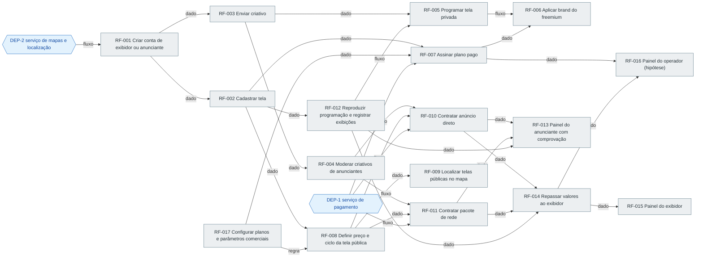

# Roadmap: viewstore

Gerado de `prd.md` versão 0.1.2 pela skill prd-writer. Status se muda na coluna Status da tabela de ondas (pendente, em andamento, feito, bloqueado, removido; bloqueado exige motivo em Observação). Grafo, ondas e situação são regenerados a partir dos blocos 'Depende de' de cada RF no PRD; para mudar uma dependência, mude o PRD.

## Situação

- Concluídos: 0 de 17 RFs (0 por cento)
- Onda atual: 1
- Liberados para começar: RF-001 (depende de DEP-2), RF-017
- Em andamento: nenhum
- Bloqueados: nenhum
- Caminho crítico restante: RF-001 → RF-002 → RF-008 → RF-010 → RF-014 → RF-015 (6 RFs)

## Grafo

Aresta A → B: B não pode ser construído ou validado sem A.

Legenda: cinza pendente, amarelo em andamento, verde feito, vermelho bloqueado, azul dependência externa.

## Ondas

RFs da mesma onda podem ser desenvolvidos em paralelo.

| Onda | RF | Nome | Prioridade | Status | Observação | Depende de |
| --- | --- | --- | --- | --- | --- | --- |
| 1 | RF-001 | Criar conta de exibidor ou anunciante | alta | pendente |  | DEP-2 |
| 1 | RF-017 | Configurar planos e parâmetros comerciais | alta | pendente |  | nenhum |
| 2 | RF-002 | Cadastrar tela | alta | pendente |  | RF-001 |
| 2 | RF-003 | Enviar criativo | alta | pendente |  | RF-001 |
| 3 | RF-004 | Moderar criativos de anunciantes | alta | pendente |  | RF-003 |
| 3 | RF-007 | Assinar plano pago | alta | pendente |  | DEP-1, RF-002, RF-017 |
| 3 | RF-008 | Definir preço e ciclo da tela pública | alta | pendente |  | RF-002, RF-017 |
| 3 | RF-012 | Reproduzir programação e registrar exibições | alta | pendente |  | RF-002 |
| 4 | RF-005 | Programar tela privada | alta | pendente |  | RF-003, RF-012 |
| 4 | RF-010 | Contratar anúncio direto | alta | pendente |  | DEP-1, RF-004, RF-008 |
| 4 | RF-011 | Contratar pacote de rede | alta | pendente |  | DEP-1, RF-004, RF-008 |
| 4 | RF-009 | Localizar telas públicas no mapa | media | pendente |  | RF-008 |
| 5 | RF-006 | Aplicar brand do freemium | alta | pendente |  | RF-005, RF-007 |
| 5 | RF-014 | Repassar valores ao exibidor | alta | pendente |  | RF-010, RF-011, RF-012 |
| 5 | RF-013 | Painel do anunciante com comprovação | media | pendente |  | RF-010, RF-011, RF-012 |
| 6 | RF-015 | Painel do exibidor | media | pendente |  | RF-014 |
| 6 | RF-016 | Painel do operador (hipótese) | media | pendente |  | RF-007, RF-014 |

Dependências externas no grafo
- DEP-1 serviço de pagamento
- DEP-2 serviço de mapas e localização
