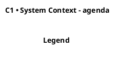
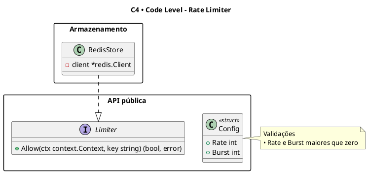

# PlantUML C4: referência de sintaxe

Leia antes de escrever o primeiro `.puml`. Tudo aqui existe porque erra fácil e o erro só aparece
na renderização, que nem sempre está disponível para conferir.

## Sumário

- Esqueleto por nível
- Ordem dos parâmetros
- Elementos permitidos por nível
- Relações
- Hipótese no desenho
- Notas
- C4 Code Level (diagrama de classes)
- Erros comuns

## Esqueleto por nível

As três primeiras linhas são fixas. O nome depois de `@startuml` é o nome do arquivo sem extensão,
e o `!pragma charset UTF-8` vem logo em seguida, porque sem ele acento e cedilha saem quebrados em
parte dos renderizadores.



| Nível | Include | Título | Layout sugerido |
|---|---|---|---|
| C1 | `!include <C4/C4_Context>` | `title C1 • System Context - <Nome>` | `LAYOUT_LEFT_RIGHT()` |
| C2 | `!include <C4/C4_Container>` | `title C2 • Container - <Nome>` | `LAYOUT_TOP_DOWN()` |
| C3 | `!include <C4/C4_Component>` | `title C3 • Component - <Nome do container>` | `LAYOUT_LEFT_RIGHT()` ou `LAYOUT_TOP_DOWN()` |
| C4 | nenhum (diagrama de classes) | `title C4 • Code Level - <Nome>` | não se aplica |

`<C4/...>` com sinais de menor e maior é a biblioteca padrão que vem dentro do PlantUML: funciona
offline e não depende de URL do GitHub. `SHOW_LEGEND()` fecha C1 a C3 e nunca aparece no C4.

## Ordem dos parâmetros

É o erro mais caro, porque não quebra a renderização: o texto vai parar no campo errado e aparece
como `<$...>` ou como descrição vazia.

| Família | Assinatura |
|---|---|
| `Person`, `Person_Ext` | `($alias, $label, $descr, $sprite, $tags, $link)` |
| `System`, `System_Ext`, `SystemDb`, `SystemQueue` (e `_Ext`) | `($alias, $label, $descr, $sprite, $tags, $link)` |
| `Container`, `ContainerDb`, `ContainerQueue` (e `_Ext`) | `($alias, $label, $techn, $descr, $sprite, $tags, $link)` |
| `Component`, `ComponentDb`, `ComponentQueue` (e `_Ext`) | `($alias, $label, $techn, $descr, $sprite, $tags, $link)` |
| `System_Boundary`, `Container_Boundary`, `Enterprise_Boundary` | `($alias, $label, $tags, $link)` |
| `Rel`, `Rel_U/D/L/R`, `BiRel` | `($from, $to, $label, $techn, $descr, $sprite, $tags, $link)` |

System não tem `$techn`; Container e Component têm, e ele vem antes de `$descr`.

```plantuml
' certo
System_Ext(pag, "Asaas", "Cobranças, assinaturas e saques por Pix")
Container(api, "API", "TypeScript, NestJS", "Borda HTTP do painel, do player e do webhook")

' errado: "Asaas API v3" vira $descr e a descrição vira $sprite
System_Ext(pag, "Asaas", "Asaas API v3", "Cobranças, assinaturas e saques")
```

Para passar só um parâmetro do fim, use o nome em vez de encher de strings vazias:
`Container(api, "API", "NestJS", "Borda HTTP", $tags="hipotese")`.

## Elementos permitidos por nível

| Nível | Pode usar | Não usa |
|---|---|---|
| C1 | `Person`, `System`, `System_Ext` (e Db, Queue), `Enterprise_Boundary`, `System_Boundary` | Container, Component, tecnologia em qualquer campo |
| C2 | o de C1 mais `Container`, `ContainerDb`, `ContainerQueue` (e `_Ext`); o sistema vira `System_Boundary` | Component |
| C3 | `Component` (e Db, Queue), dentro de um `Container_Boundary`; containers e sistemas vizinhos como `_Ext` ou `Container` fora da fronteira | detalhe de código |

Em C2, todo container do sistema tem `$techn` preenchido com a tecnologia e, quando a fonte der,
a versão. Em C1 não há tecnologia: "Banco PostgreSQL" vira só parte do sistema.

## Relações

Uma relação por dependência real que a fonte descreve, no sentido de quem inicia a chamada. O
rótulo é um verbo curto ("Envia cobranças", "Consulta versão do manifesto") e o `$techn` é o
protocolo da tabela de interfaces quando ela existir ("REST/JSON, HTTPS", "BullMQ sobre Redis").
Em C1 a relação não tem `$techn`.

## Hipótese no desenho

O que a fonte não diz e você precisou completar (um ator inferido de um papel, uma relação que o
fluxo sugere mas não nomeia) recebe a tag `hipotese`, que desenha a borda ou a linha tracejada e
entra na legenda. Declare as duas tags logo depois do `title`, só no diagrama que as usa:

```plantuml
AddElementTag("hipotese", $legendText="hipótese", $borderStyle=DashedLine())
AddRelTag("hipotese", $legendText="hipótese", $lineStyle=DashedLine())

Person(operador, "Operador", "Modera criativos e acompanha repasses", $tags="hipotese")
Rel(worker, ses, "Envia e-mails", $tags="hipotese")
```

A tag não tem acento (é identificador); o `$legendText` tem. Todo elemento com a tag aparece na
seção Hipóteses do `.md`, e o validador confere.

## Notas

Nota explica o que o desenho não mostra: garantia, invariante, decisão que surpreende. Não repete
o nome do elemento nem a descrição dele.

```plantuml
note right of fin
  Invariantes
  • Venda, cobrança e lançamento na mesma transação
  • Saldo e crédito nunca negativos (constraint)
end note
```

- Até 5 bullets por nota, uma linha cada, perto de 10 a 12 palavras.
- Bullet com `•`. Sem emoji.
- Sem referência a seção do documento de origem ("ver Fluxos, item 3"): isso vai no `.md`.
- Várias notas pequenas em elementos diferentes são melhores que uma nota grande.

## C4 Code Level (diagrama de classes)

O nível 4 não usa a biblioteca C4: é diagrama de classes do PlantUML, organizado em `package`.



- `interface`, `class`, `enum`, `abstract class`; estereótipos `<<struct>>` e `<<function>>` para
  linguagens sem classe.
- Assinaturas como a fonte escreveu, na sintaxe da linguagem dela.
- Relações UML: `..|>` implementa, `--|>` herda, `-->` usa, `*--` compõe, `o--` agrega.
- Elemento inferido leva `<<hipótese>>` como estereótipo (aqui não há tag C4).

## Erros comuns

- Parêntese ou aspas sem fechar numa linha: a renderização para inteira. Uma macro por linha.
- Alias usado em `Rel` que não foi declarado: o PlantUML cria um elemento genérico solto, sem erro.
- Alias com hífen ou acento: use só letras sem acento, dígitos e `_` (`painel_web`, não `painel-web`).
- `SHOW_LEGEND()` no C4 Code Level: quebra, porque a macro é da biblioteca C4.
- Fronteira com chave na linha seguinte: escreva `System_Boundary(ag, "agenda") {` na mesma
  linha e feche com `}` sozinho.
