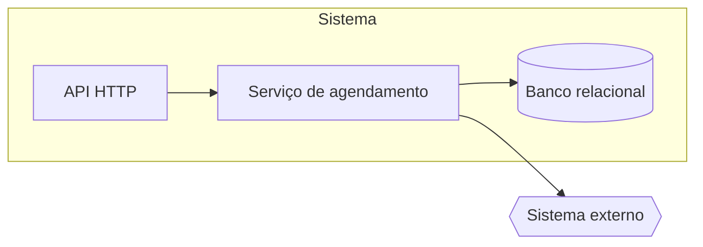

# HLD: [nome do sistema ou módulo]

Versão: 0.1.0
Data: AAAA-MM-DD
Responsável: [responsável técnico]
PRD: [docs/product/prd.md versão X.Y.Z | não há PRD]

---

## Objetivo técnico

[Até 5 frases: o que o sistema ou módulo precisa fazer tecnicamente e que problema técnico do estado atual resolve. Cite o PRD pelos RF-NNN em vez de recontar a regra de negócio.]

Problemas técnicos endereçados
- [problema 1: o que está ruim hoje em termos técnicos (acoplamento, latência, operação manual, falta de rastreio)]
- [problema 2]

Sistemas e módulos conectados
- [sistema ou módulo 1: o que este sistema troca com ele e em que direção]
- [sistema 2]

---

## Arquitetura geral

[Até 5 frases: topologia, camadas, estilo arquitetural e por que esse arranjo atende os requisitos não funcionais do PRD.]

Ambiente de implantação
- [cloud | on-premises | híbrido]: [onde cada parte roda e como se separa por ambiente]

Tecnologias principais

| Tecnologia | Papel | Decisão |
| --- | --- | --- |
| [tecnologia 1] | [para que serve neste sistema] | [ADR-NNNN | ADR-NNNN (proposed) | pendente de ADR] |
| [tecnologia 2] | [papel] | [ADR-NNNN | pendente de ADR] |

Padrões adotados
- [padrão 1: por que ele aqui, em uma frase]
- [padrão 2]

---

## Componentes e responsabilidades

| Componente | Responsabilidades | Dependências |
| --- | --- | --- |
| [componente 1] | [o que faz; quem persiste, quem faz cache, quem orquestra] | [internas e externas] |
| [componente 2] | [responsabilidades] | [dependências] |

---

## Fluxos de requisição e de dados

### Fluxo: [nome do fluxo principal, com o RF que atende]
- [passo 1: quem chama quem, com que dado]
- [passo 2: validação ou transformação]
- [passo 3: persistência, fila ou evento]
- [passo 4: resposta ou efeito observável]

### Fluxo: [segundo fluxo relevante]
- [passo 1]
- [passo 2]
- [passo 3]

Fluxo de dados
- [origem → transformação → destino, para cada dado que atravessa fronteira de componente]

Persistência e replicação
- [onde cada dado grava, como replica e que consistência se promete]

---

## Modelo de dados (alto nível)

Entidades principais
- [Entidade 1: o que representa e os atributos que importam para a arquitetura]
- [Entidade 2]

Relações
- [Entidade 1 1:N Entidade 2: regra que a relação carrega]

Fonte de verdade
- [dado ou entidade: sistema ou componente que é o source of truth]

Sincronização e cache
- [o que é cacheado, onde, por quanto tempo, como invalida]

Versionamento e retenção
- [esquemas versionados como; por quanto tempo cada dado fica e o que acontece depois]

---

## Interfaces públicas

| Nome | Tipo | Protocolo | Exposição | SLA e limites |
| --- | --- | --- | --- | --- |
| [API X] | API | REST/JSON | externa | [ex: p95 300 ms, 100 req/s por cliente] |
| [Fila Y] | fila | [ex: AMQP] | interna | [ex: consumo de 500 msg/s, entrega ao menos uma vez] |

---

## Escalabilidade e disponibilidade

Abordagem geral
- [como o sistema cresce e como sobrevive a falhas, em uma ou duas frases]

Técnicas aplicadas
- [load balancing, autoscaling, cache, particionamento, backpressure, rate limiting: só o que se aplica, com onde]

Metas
- Disponibilidade: [ex: 99.9 por cento mensal para interfaces externas; 99.5 por cento para internas]
- Recuperação: [RTO e RPO, ex: RTO 1 hora, RPO 15 minutos]
- Capacidade: [ex: 10 vezes o volume atual sem mudança de arquitetura]

---

## Segurança

Autenticação
- [como usuários e sistemas provam quem são]

Autorização
- [modelo de permissão: papéis, escopos, quem decide]

Proteção de dados
- [criptografia em trânsito e em repouso; dados pessoais e sensíveis; anonimização; retenção]

Gestão de segredos
- [onde ficam, como rotacionam, quem acessa]

---

## Observabilidade

Logs
- [formato, campos obrigatórios (correlação, usuário, componente), retenção]

Métricas
- [métricas essenciais por interface e componente, com o que dispara alerta]

Tracing
- [propagação de contexto entre componentes e amostragem]

Dashboards e alertas
- [painéis mínimos e alertas ligados às metas]

---

## Riscos arquiteturais e mitigação

### [risco 1 em uma frase]
- **Probabilidade:** [baixa|media|alta]
- **Impacto:** [o que acontece se ocorrer]
- **Mitigação:**
  - [ação 1]
  - [ação 2]
- **Plano de contingência:** [plano B se ocorrer mesmo assim]

### [risco 2 em uma frase]
- **Probabilidade:** [baixa|media|alta]
- **Impacto:** [impacto]
- **Mitigação:**
  - [ação]
- **Plano de contingência:** [plano B]

---

## Rastreabilidade com o PRD

[sem PRD: abra com uma linha dizendo que não há PRD, que os requisitos vieram do brief numerados como RB-NN e serão trocados pelos números do PRD quando ele existir (sem escrever RF-NNN literal, que o validador lê como placeholder). Com PRD: apague esta linha.]

| Requisito | Componentes | Interfaces | Fluxo |
| --- | --- | --- | --- |
| RF-001 | [componentes que o implementam] | [interfaces envolvidas] | [nome do fluxo] |
| RF-002 | [componentes] | [interfaces] | [fluxo] |

Requisitos não funcionais do PRD
- [categoria do PRD (ex: Performance)]: [seção e meta deste HLD que a atende]

---

## ADRs e próximos passos

ADRs associados
- [ADR-NNNN título: o que ele fixa neste HLD]

Decisões pendentes de ADR
- [decisão: opções em jogo e critério para escolher]

Próximos passos
- [ação técnica planejada, com o que destrava]
