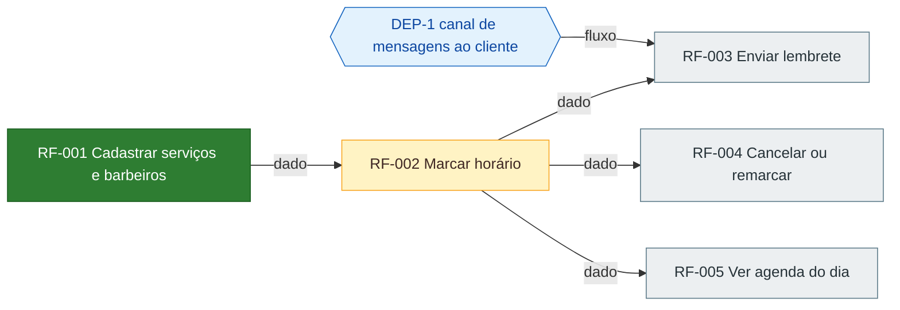

# Roadmap: Agenda Barbearia

Gerado de `prd.md` versão 0.1.0 pela skill prd-writer. Status se muda na coluna Status da tabela de ondas (pendente, em andamento, feito, bloqueado, removido; bloqueado exige motivo em Observação). Grafo, ondas e situação são regenerados a partir dos blocos 'Depende de' de cada RF no PRD; para mudar uma dependência, mude o PRD.

## Situação

- Concluídos: 1 de 5 RFs (20 por cento)
- Onda atual: 2
- Liberados para começar: nenhum
- Em andamento: RF-002
- Bloqueados: nenhum
- Caminho crítico restante: RF-002 → RF-003 (2 RFs)

## Grafo

Aresta A → B: B não pode ser construído ou validado sem A.

Legenda: cinza pendente, amarelo em andamento, verde feito, vermelho bloqueado, azul dependência externa.

## Ondas

RFs da mesma onda podem ser desenvolvidos em paralelo.

| Onda | RF | Nome | Prioridade | Status | Observação | Depende de |
| --- | --- | --- | --- | --- | --- | --- |
| 1 | RF-001 | Cadastrar serviços e barbeiros | alta | feito |  | nenhum |
| 2 | RF-002 | Marcar horário | alta | em andamento |  | RF-001 |
| 3 | RF-003 | Enviar lembrete | alta | pendente |  | DEP-1, RF-002 |
| 3 | RF-004 | Cancelar ou remarcar | alta | pendente |  | RF-002 |
| 3 | RF-005 | Ver agenda do dia | media | pendente |  | RF-002 |

Dependências externas no grafo
- DEP-1 canal de mensagens ao cliente
