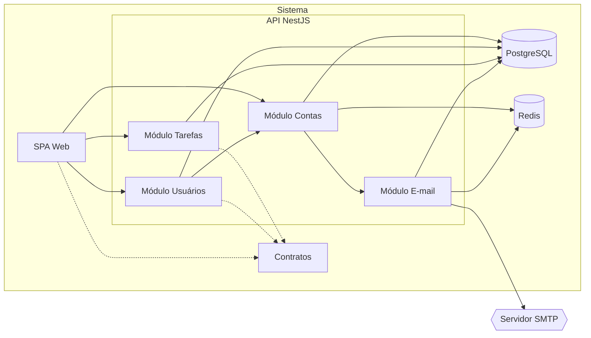

# HLD: Template de aplicação web com contas e tarefas

Versão: 0.2.3
Data: 2026-10-29
Responsável: Maicon Souza (hipótese)
PRD: docs/product/prd.md versão 0.1.0

---

## Objetivo técnico

Monorepo com uma API NestJS e uma SPA React, sobre PostgreSQL, que entrega contas de usuário (RF-001 a RF-007, RF-012, RF-013) e um cadastro de tarefas (RF-008 a RF-011) prontos para um projeto novo. O ambiente local inteiro sobe com um `docker compose up` mais um comando de preparo do banco, e o módulo de tarefas é o padrão de vertical slice que o dev copia para cada entidade nova. Os e-mails transacionais saem por SMTP genérico, para trocar a caixa de teste local por um provedor real só com configuração.

Problemas técnicos endereçados
- Cada projeto novo gasta de 1 a 3 dias montando monorepo, autenticação com confirmação por e-mail, papéis e um primeiro CRUD antes da primeira feature real (PRD).
- Sem um padrão fixo de onde ficam rota, regra, acesso a dados e teste, cada entidade nova é organizada de um jeito, o que impede a meta de criar uma entidade em até 2 horas.
- Ambiente local montado à mão (Node, banco, caixa de e-mail) diverge de máquina para máquina e estoura a meta de 15 minutos de setup.

Sistemas e módulos conectados
- Servidor SMTP: a API envia os e-mails de confirmação, recuperação e aviso de troca de senha; fluxo de mão única, da API para o servidor. No ambiente local é o Mailpit, cuja interface web mostra os e-mails ao dev.

---

## Arquitetura geral

Monólito modular: uma API NestJS sem estado em memória, organizada em módulos por funcionalidade, e uma SPA estática servida em origem própria. A SPA fica em `app.<domínio>` e a API em `api.<domínio>`, com o cookie de sessão do Better Auth no domínio pai, o que mantém o cookie de primeira parte também no Safari. O PostgreSQL é a fonte de verdade do domínio, e o Redis, persistido com AOF, hospeda a fila de e-mail (BullMQ) e os contadores de curta duração (bloqueio por e-mail e rate limit). Esse arranjo cumpre os 99,5 por cento do PRD com réplicas da API atrás de um balanceador e mantém um único processo de aplicação a operar, o que serve à meta de 15 minutos.

As arestas tracejadas são dependências de build (tipos e esquemas compartilhados), não chamadas em runtime.

Ambiente de implantação
- Local: Docker Compose (ADR-0006) com os serviços api, web, postgres, redis e mailpit, código montado nos containers e hot reload; o preparo do banco (migrações e primeiro admin) roda por um alvo do `Makefile`, `make db-setup` (hipótese).
- Fora do local: agnóstico de destino. O template entrega duas imagens Docker multi-stage (ADR-0005), uma da API e uma da SPA estática, e o contrato de configuração por variáveis de ambiente; PostgreSQL, Redis (com AOF e `noeviction`), SMTP, TLS e backup ficam a cargo do destino escolhido pelo projeto gerado.
- Ambientes se separam só por variáveis de ambiente (URLs, credenciais, domínio do cookie); a mesma imagem roda em qualquer um.

Tecnologias principais

| Tecnologia | Papel | Decisão |
| --- | --- | --- |
| Turborepo | Orquestra lint, test e build entre os pacotes do monorepo, com cache | ADR-0002 |
| pnpm | Gerenciador de pacotes que fornece os workspaces ao Turborepo | ADR-0012 |
| Node.js 26 LTS | Runtime da API, do build e das imagens, acima do piso de 22.22 | ADR-0013 |
| NestJS | Framework da API: módulos, injeção de dependência, testes | ADR-0003 |
| Nest CLI | Scaffold, geração, build e watch da API, fixado no lockfile | ADR-0009 |
| Vite e React Router (modo data) | Build e roteamento da SPA estática | ADR-0004 |
| PostgreSQL 18 | Banco relacional, fonte de verdade do domínio | ADR-0007 |
| Prisma 7 | ORM e migrações versionadas do esquema | ADR-0008 |
| Better Auth | Cadastro, confirmação, sessão em cookie no banco, recuperação, troca de senha, plugin admin | ADR-0010 |
| Valkey 9 (protocolo Redis) | Fila de e-mail do BullMQ, contador de bloqueio por e-mail e armazenamento do rate limit do Better Auth | ADR-0014 |
| BullMQ | Fila de jobs sobre o Redis para o envio de e-mail, com retry e backoff, integrada ao Nest por `@nestjs/bullmq` | ADR-0015 |
| SMTP (Nodemailer) | Protocolo único de envio de e-mail, local e em produção | ADR-0017 |
| Mailpit | Caixa SMTP de teste do ambiente local, com interface web e API | ADR-0016 |
| nestjs-pino | Logs JSON estruturados com redação de dados pessoais | ADR-0018 |
| OpenTelemetry | Métricas e tracing com exportação OTLP para o coletor do destino | ADR-0019 |
| @nestjs/swagger | Documento OpenAPI gerado a partir dos controllers e DTOs, com o plugin CLI e TypeScript 6 | ADR-0020 |
| Docker multi-stage | Artefato de deploy de cada app | ADR-0005 |
| Docker Compose | Ambiente de desenvolvimento completo | ADR-0006 |

Padrões adotados
- Vertical slice com DDD tático na API (ADR-0011): um módulo por funcionalidade, uma pasta por caso de uso, repositório como classe abstrata em `domain/` e implementação Prisma em `infra/`; é o padrão que o dev copia.
- REST/JSON com versão maior na URL (`/api/v1`) para as rotas do template; as rotas do Better Auth ficam em `/api/auth`, no formato da biblioteca.
- Tipos compartilhados: DTOs e esquemas de validação num pacote do monorepo (Contratos), usados pela API e pela SPA, para o contrato HTTP não divergir entre os dois lados.
- Envio de e-mail assíncrono: a requisição só enfileira, e a falha do SMTP nunca derruba o cadastro (RF-001 cria a conta mesmo se o envio falhar).
- API sem estado em memória: sessão, fila, bloqueio e rate limit vivem no PostgreSQL ou no Redis, então qualquer réplica atende qualquer requisição.

---

## Componentes e responsabilidades

| Componente | Responsabilidades | Dependências |
| --- | --- | --- |
| SPA Web | Telas, rotas protegidas e redirecionamento para entrar; `loader` e `action` do React Router chamam a API com o cookie de sessão. Não persiste nada além do cookie. | Módulo Contas, Módulo Usuários, Módulo Tarefas (via HTTP); Contratos (build) |
| Contratos | DTOs e esquemas de validação compartilhados (regra de senha, título obrigatório, filtros e paginação). Só existe em tempo de build. | nenhuma |
| Módulo Contas | Monta o Better Auth: cadastro, confirmação, sessão, saída, recuperação e troca de senha; perfil (`/api/v1/me`); bloqueio de 5 erros seguidos por e-mail em hooks antes e depois do sign-in. Persiste usuário, sessão, credencial e verificação. | PostgreSQL, Redis, Módulo E-mail |
| Módulo Usuários | Listagem e busca de contas para admin; promover, rebaixar, desativar e reativar com as travas (si mesmo, último admin ativo); grava a trilha de auditoria na mesma transação da mudança. | Módulo Contas (plugin admin do Better Auth), PostgreSQL |
| Módulo Tarefas | CRUD das tarefas da pessoa logada com filtro por situação e paginação; todo acesso filtra pela dona. É o slice de referência do template. | PostgreSQL |
| Módulo E-mail | Recebe pedidos de envio, cria jobs no BullMQ, consome a fila no mesmo processo da API, lê o endereço do usuário, renderiza o e-mail em pt-BR e envia por SMTP; orquestra retry e jobs que esgotaram as tentativas. | Redis, PostgreSQL, Servidor SMTP |
| PostgreSQL | Fonte de verdade de contas, sessões, verificações, tarefas e auditoria. | nenhuma |
| Redis | Fila de e-mail do BullMQ, persistida com AOF a cada segundo e `maxmemory-policy noeviction`; contadores com TTL de falhas de login por e-mail e de rate limit. Fonte de verdade só dos jobs pendentes. | nenhuma |

---

## Fluxos de requisição e de dados

### Fluxo: Cadastro e confirmação (RF-001, RF-002)
- A SPA Web envia nome, e-mail e senha para `POST /api/auth/sign-up/email`; o Módulo Contas aplica o rate limit por IP com contadores no Redis.
- O Módulo Contas valida os campos com o esquema de Contratos (regra de senha de 8 caracteres com letra e número), normaliza o e-mail para minúsculas e recusa e-mail já cadastrado.
- O Better Auth grava no PostgreSQL o usuário com papel usuário e situação pendente, a credencial com hash scrypt e o token de confirmação válido por 24 horas.
- No callback de envio de confirmação, o Módulo E-mail cria o job na fila `email.send` do BullMQ, depois do commit da conta; a API responde e a SPA informa que o link foi enviado.
- O worker do BullMQ no Módulo E-mail pega o job, monta o e-mail com o link e envia ao Servidor SMTP; falha gera nova tentativa, até 5, com backoff exponencial a partir de 5 segundos.
- A pessoa abre o link; o Módulo Contas confere validade e uso, marca o e-mail como verificado, muda a conta para ativa e redireciona a SPA para entrar.

### Fluxo: CRUD de tarefa isolado (RF-008 a RF-011)
- A SPA Web chama `/api/v1/tasks` (criar, listar com `?status=&page=`, editar, concluir, excluir) com o cookie de sessão.
- O guard global do Better Auth resolve a sessão no PostgreSQL; sem sessão válida, a API responde 401 e a SPA leva para entrar, guardando a página pedida.
- O controller do slice valida o corpo com o esquema de Contratos e passa ao handler o `ownerId` da sessão, nunca um id vindo do cliente.
- O handler chama o repositório abstrato do domínio; a implementação Prisma inclui `owner_id` no `WHERE` de toda leitura, alteração e exclusão.
- Tarefa inexistente ou de outra conta resulta em zero linhas e a API responde 404 "tarefa não encontrada", sem distinguir os dois casos.
- A listagem devolve no máximo 20 itens, mais recentes primeiro, com o total para a paginação; a SPA revalida o `loader` depois de cada `action`.

Fluxo de dados
- SPA Web → Módulo Contas: credenciais e dados de cadastro em JSON sobre HTTPS; a senha vira hash scrypt antes de gravar e nunca sai da API.
- SPA Web → Módulo Tarefas: título, descrição e situação; a dona vem sempre da sessão.
- Módulo Contas → Módulo E-mail: tipo do e-mail, id do usuário e o link com token; o job guarda o id, e o endereço é lido do usuário na hora do envio.
- Módulo E-mail → Servidor SMTP: mensagem MIME com destinatário, assunto e corpo em pt-BR.
- Módulo Usuários → Módulo Contas: mudança de papel e banimento (desativação) pelo plugin admin, que revoga as sessões da conta.
- Módulo E-mail → Redis: job com tipo, id do usuário e link; o worker lê o job do Redis e o endereço do PostgreSQL.
- Módulo Contas → Redis: chave por e-mail normalizado com o número de falhas seguidas e TTL de 15 minutos; chaves de janela do rate limit por IP e caminho.

Persistência e replicação
- Consistência forte dentro do PostgreSQL: usuário, credencial e verificação gravam juntos; mudança de papel ou situação e o registro de auditoria gravam na mesma transação.
- Todo e-mail entra na fila depois do commit da ação, porque a fila fica no Redis, fora da transação do PostgreSQL; a perda nesse intervalo é coberta pelo reenvio (RF-001, RF-002) e por um novo pedido (RF-005).
- Envio de e-mail é eventual, com janela de até 2 minutos, e entrega ao menos uma vez.
- Sem replicação no template: PostgreSQL e Redis em instância única; réplica e backup ficam a cargo do destino.
- O Redis é persistido com AOF a cada segundo e `noeviction` (recomendação de produção do BullMQ): uma queda perde no máximo cerca de 1 segundo de jobs; bloqueios e janelas de rate limit também sobrevivem ao reinício.

---

## Modelo de dados (alto nível)

Entidades principais
- Usuário: nome, e-mail único em minúsculas, papel (usuário ou admin), situação (pendente, ativa, desativada) e situação anterior para a reativação; tabela `user` do Better Auth com campos do plugin admin.
- Sessão: token do cookie, usuário, expiração e origem; tabela `session` do Better Auth, apagada na saída e na revogação.
- Credencial: hash scrypt da senha ligado ao usuário; tabela `account` do Better Auth.
- Verificação: token de confirmação (24 horas) ou de recuperação (1 hora), de uso único; tabela `verification` do Better Auth.
- Tarefa: título, descrição, situação (pendente ou concluída), dona, criada e alterada em; índice em (dona, situação, criada em).
- Registro de auditoria: conta alterada, quem fez, campo (papel ou situação), valor anterior, valor novo e horário; só inclusão.
- Job de e-mail: tipo, id do usuário, link, tentativas e estado; chaves do BullMQ no Redis.

Relações
- Usuário 1:N Sessão: desativar a conta, recuperar a senha ou trocar a senha revoga sessões (todas, ou todas menos a atual na troca).
- Usuário 1:N Credencial: no template há só a credencial de e-mail e senha.
- Usuário 1:N Tarefa: toda tarefa tem exatamente uma dona, por chave estrangeira obrigatória (PRD); não há exclusão de conta, então a regra de exclusão em cascata não é exercida.
- Usuário 1:N Registro de auditoria, duas vezes: como conta alterada e como autor da mudança.

Fonte de verdade
- Usuário, Sessão, Credencial, Verificação, Tarefa e Registro de auditoria: PostgreSQL, escritos só pela API.
- Job de e-mail: Redis, nas chaves do BullMQ, enquanto pendente.
- Bloqueio por e-mail e rate limit: Redis, dado efêmero que pode se perder sem dano ao domínio.

Sincronização e cache
- Sem cache no servidor: toda leitura vai ao PostgreSQL com índice, e o cookie cache do Better Auth fica desligado para a revogação de sessão valer na próxima requisição.
- Na SPA, o dado vive no `loader` da rota e é revalidado depois de cada `action`.

Versionamento e retenção
- Esquema versionado por migrações do Prisma no repositório, aplicadas pelo preparo do banco; o contrato HTTP é versionado em `/api/v1`.
- Registro de auditoria: retenção indefinida, nunca apagado pela aplicação.
- Conta desativada: mantém dados e tarefas, reversível pela reativação; expurgo ou anonimização a pedido do titular (LGPD) fica para o projeto gerado.
- Tarefa excluída: apagada de forma definitiva (PRD).
- Sessões e verificações vencidas são removidas pelo Better Auth; jobs concluídos e falhos do BullMQ são removidos por `removeOnComplete` e `removeOnFail`, com prazo a definir na spec da fundação (hipótese).

---

## Interfaces públicas

| Nome | Tipo | Protocolo | Exposição | SLA e limites |
| --- | --- | --- | --- | --- |
| API de autenticação (`/api/auth`) | API | REST/JSON, cookie de sessão | externa | p95 300 ms, exceto sign-in, sign-up e troca de senha, que pagam o custo do scrypt; rate limit por IP de 100 req a cada 10 s, e 5 a cada 60 s em sign-in, sign-up e recuperação |
| API REST v1 (`/api/v1`: perfil, tarefas, admin) | API | REST/JSON, cookie de sessão | externa | p95 300 ms; listagens com no máximo 20 itens por página |
| Fila de e-mail (`email.send`) | fila | BullMQ sobre Redis | interna | processado em até 2 minutos; entrega ao menos uma vez; 5 tentativas com backoff exponencial a partir de 5 s, depois o job fica como falho para inspeção |
| Documento OpenAPI (`/api/docs`) | API | HTTP, OpenAPI 3 | interna | publicado só fora de produção; sem SLA, 1 documento por versão da API |

---

## Escalabilidade e disponibilidade

Abordagem geral
- A API cresce por réplicas horizontais atrás do balanceador do destino, já que não guarda estado em memória; PostgreSQL e Redis ficam em instância única no template e crescem verticalmente.
- Falha de uma réplica da API não perde trabalho: a sessão está no banco e o job pendente fica na fila até outra réplica consumir.

Técnicas aplicadas
- Load balancing entre réplicas da API, fornecido pelo destino.
- Rate limiting nas rotas de autenticação, com contadores no Redis compartilhados entre réplicas.
- Fila no BullMQ: várias réplicas consomem `email.send` como workers concorrentes sem pegar o mesmo job.
- Paginação por offset com índice em (dona, situação, criada em) para a listagem de tarefas.
- Degradação controlada: com o Redis fora do ar, o login segue sem bloqueio nem rate limit (fail-open), registra erro e dispara alerta; os e-mails param até o Redis voltar, e o cadastro responde oferecendo o reenvio.

Metas
- Disponibilidade: 99,5 por cento mensal na API de autenticação e na API REST v1, como referência para o projeto gerado ajustar (PRD).
- Recuperação: RTO de 4 horas e RPO de 24 horas, com backup diário do PostgreSQL feito pelo destino e restauração recriando as imagens.
- Capacidade: referência atual de até 1.000 contas, 50 req/s de pico e 100.000 tarefas; 10 vezes isso só com réplicas da API, sem mudar a arquitetura.
- Latência: p95 de 300 ms no servidor, abaixo do 1 segundo percebido que o PRD pede.

---

## Segurança

Autenticação
- Pessoas se autenticam por e-mail e senha no Better Auth (ADR-0010), com sessão em cookie `httpOnly` e `secure`, gravada no PostgreSQL; duração de 7 dias, renovada a cada 1 dia de uso.
- Cookie emitido para o domínio pai com `crossSubDomainCookies`, e `trustedOrigins` restrito à origem da SPA; CORS da API aceita credenciais só dessa origem.
- Conta pendente ou desativada não abre sessão; 5 falhas seguidas para o mesmo e-mail bloqueiam novas tentativas por 15 minutos (contador no Redis).
- Guard global do Better Auth exige sessão em toda rota; só cadastro, confirmação, entrar e recuperação de senha são marcadas como anônimas.

Autorização
- Dois papéis, usuário e admin, mantidos pelo plugin admin do Better Auth; só admin muda papel ou situação, e só pelo Módulo Usuários.
- Guard de papel nas rotas `/api/v1/admin`: papel usuário recebe 403 "acesso negado" sem dado de conta.
- Isolamento de tarefas no domínio: todo método do repositório de tarefas recebe o `ownerId` da sessão e filtra por ele; tarefa alheia responde 404, inclusive para admin.
- Travas no Módulo Usuários: admin não rebaixa nem desativa a si mesmo, e nenhuma ação deixa o sistema sem admin ativo.

Proteção de dados
- TLS em todo tráfego externo, terminado pelo destino; dentro do Compose local o tráfego é HTTP.
- Senha guardada só como hash scrypt; nunca trafega de volta, nunca vai para log nem para e-mail.
- Dados pessoais (nome, e-mail) ficam no PostgreSQL; criptografia em repouso é a do disco do destino.
- Logs e traces sem nome, e-mail, senha, cookie ou cabeçalho de autorização, por redação declarada no logger (LGPD, PRD).
- Links de confirmação (24 horas) e recuperação (1 hora) de uso único; resposta da recuperação é a mesma para e-mail com e sem conta.

Gestão de segredos
- Segredos (`BETTER_AUTH_SECRET`, URL do banco, URL do Redis, credencial SMTP, e-mail do primeiro admin) vêm de variáveis de ambiente, validadas na subida da API, que falha se faltar alguma.
- Local: `.env` gerado a partir de `.env.example` e ignorado pelo git; o `gitleaks` do harness barra segredo commitado.
- Fora do local: o cofre do destino injeta as variáveis; nenhum segredo entra na imagem Docker. A rotação é do destino; trocar o `BETTER_AUTH_SECRET` invalida as sessões abertas.

---

## Observabilidade

Logs
- JSON por linha via nestjs-pino, com `requestId` propagado ponta a ponta, `userId`, componente, rota, status e latência.
- Redação por caminho remove `email`, `name`, `password`, `cookie` e `authorization` antes de escrever; teste automatizado garante que cadastro e login não vazam esses campos.
- Retenção de 30 dias no destino.

Métricas
- Por interface: taxa de requisições, taxa de erro 5xx e latência p95, via auto-instrumentação HTTP do OpenTelemetry.
- Fila de e-mail: jobs pendentes, idade do job mais antigo, falhas por tentativa e jobs falhos; uso de memória do Redis contra o `maxmemory`.
- Componente: conexões do pool do PostgreSQL, disponibilidade do Redis e do PostgreSQL pelo health check.
- Negócio: bloqueios de login por hora e cadastros sem confirmação após 24 horas.

Tracing
- OpenTelemetry com propagação W3C Trace Context na API, cobrindo HTTP, Prisma e o consumo do job de e-mail; exportação OTLP para o coletor do destino, desligada quando não há endpoint configurado.
- Amostragem de 10 por cento dos traces e 100 por cento dos traces com erro, decidida no coletor.

Dashboards e alertas
- Painel por interface com erro, p95 e vazão, e painel da fila de e-mail.
- Alerta de taxa de erro 5xx acima de 1 por cento por 5 minutos, ligado à meta de 99,5 por cento.
- Alerta de p95 acima de 300 ms por 5 minutos na API REST v1.
- Alerta de job de e-mail pendente há mais de 2 minutos ou de qualquer job falho, ligado aos 2 minutos do PRD.
- Alerta de health check do Redis ou do PostgreSQL falhando por 1 minuto; o do Redis sinaliza o login em fail-open e a fila de e-mail parada.

---

## Riscos arquiteturais e mitigação

### A integração de comunidade do Better Auth com o Nest para de acompanhar uma das duas bibliotecas
- **Probabilidade:** media
- **Impacto:** `@thallesp/nestjs-better-auth` trava a atualização do NestJS ou do Better Auth, que é justamente o risco de envelhecimento do template apontado no PRD.
- **Mitigação:**
  - Versão fixada no lockfile e atualização só com a suíte verde.
  - Testes de ponta a ponta de RF-001 a RF-007 rodando a cada atualização de dependência.
  - Uso do pacote isolado no Módulo Contas, sem decorators dele espalhados pelos outros módulos além do guard.
- **Plano de contingência:** montar o handler do Better Auth direto no adapter HTTP do Nest e escrever o guard de sessão no template, sem o pacote.

### Peças de infraestrutura demais para um template, contra a meta de 2 horas por entidade
- **Probabilidade:** media
- **Impacto:** Redis, BullMQ e OpenTelemetry aumentam o que o dev precisa entender antes de copiar o padrão, e o tempo de criar uma entidade nova passa de 2 horas.
- **Mitigação:**
  - O Módulo Tarefas, que é o padrão a copiar, não toca Redis, BullMQ nem OpenTelemetry.
  - OpenTelemetry desligado por padrão, sem endpoint OTLP configurado.
  - README separa "o padrão" de "a infraestrutura", e o ensaio de 2 horas do PRD mede isso a cada versão.
- **Plano de contingência:** desligar o OpenTelemetry e documentar BullMQ e Redis como infraestrutura pronta que o padrão de Tarefas não toca, com um guia de entidade nova que não os menciona.

### O Redis vira ponto único de falha do e-mail e da proteção do login
- **Probabilidade:** media
- **Impacto:** com o Redis fora do ar ou sem persistência no destino, nenhum e-mail sai (ninguém confirma conta nem recupera senha) e o login fica sem bloqueio nem rate limit.
- **Mitigação:**
  - AOF a cada segundo e `maxmemory-policy noeviction` no Compose, e exigidos do destino no README.
  - Alerta de health check do Redis em 1 minuto e de job de e-mail pendente há mais de 2 minutos.
- **Plano de contingência:** restaurar o Redis do AOF e pedir reenvio às contas pendentes criadas na janela da queda.

---

## Rastreabilidade com o PRD

| Requisito | Componentes | Interfaces | Fluxo |
| --- | --- | --- | --- |
| RF-001 Criar conta | SPA Web, Módulo Contas, Módulo E-mail, PostgreSQL, Redis | API de autenticação, Fila de e-mail | Cadastro e confirmação |
| RF-002 Confirmar e-mail | SPA Web, Módulo Contas, Módulo E-mail, Redis | API de autenticação, Fila de e-mail | Cadastro e confirmação |
| RF-003 Entrar | SPA Web, Módulo Contas, Redis | API de autenticação | nenhum dedicado |
| RF-004 Sair | SPA Web, Módulo Contas | API de autenticação | nenhum dedicado |
| RF-005 Recuperar senha | SPA Web, Módulo Contas, Módulo E-mail, Redis | API de autenticação, Fila de e-mail | nenhum dedicado |
| RF-006 Editar perfil | SPA Web, Módulo Contas | API REST v1 | nenhum dedicado |
| RF-007 Alterar senha | SPA Web, Módulo Contas, Módulo E-mail, Redis | API de autenticação, Fila de e-mail | nenhum dedicado |
| RF-008 Criar tarefa | SPA Web, Módulo Tarefas, Contratos, PostgreSQL | API REST v1 | CRUD de tarefa isolado |
| RF-009 Listar tarefas | SPA Web, Módulo Tarefas, Contratos, PostgreSQL | API REST v1 | CRUD de tarefa isolado |
| RF-010 Editar e concluir tarefa | SPA Web, Módulo Tarefas, Contratos, PostgreSQL | API REST v1 | CRUD de tarefa isolado |
| RF-011 Excluir tarefa | SPA Web, Módulo Tarefas, Contratos, PostgreSQL | API REST v1 | CRUD de tarefa isolado |
| RF-012 Listar usuários | SPA Web, Módulo Usuários | API REST v1 | nenhum dedicado |
| RF-013 Alterar papel ou desativar usuário | SPA Web, Módulo Usuários, Módulo Contas, PostgreSQL | API REST v1 | nenhum dedicado |

Requisitos não funcionais do PRD
- Performance: Interfaces públicas e Metas (p95 de 300 ms no servidor, abaixo de 1 segundo percebido); fila de e-mail processada em até 2 minutos, com alerta.
- Disponibilidade: Metas (99,5 por cento mensal), réplicas da API sem estado e fail-open do Redis.
- Segurança e autorização: Segurança (guard global, guard de papel, `ownerId` no repositório, scrypt, links de uso único).
- Auditoria e rastreabilidade: Módulo Usuários grava o registro de auditoria na mesma transação da mudança; retenção indefinida.
- Confiabilidade e integridade de dados: travas de último admin no Módulo Usuários; chave estrangeira obrigatória de Tarefa para Usuário no PostgreSQL.
- Compatibilidade: SPA Web estática para navegadores dos últimos 2 anos (ADR-0004); e-mails renderizados em pt-BR pelo Módulo E-mail.
- Compliance: redação de dados pessoais nos logs e traces (Observabilidade); expurgo a pedido do titular declarado como lacuna em Versionamento e retenção.
- Acessibilidade: sem meta no PRD; não se aplica a este HLD.

Lacuna a verificar: o critério do RF-002 "depois de um reenvio, o link anterior não ativa mais a conta" depende de como o Better Auth gera o token de confirmação, o que a documentação consultada não diz; a spec do RF-002 confirma o comportamento e, se o token não tiver estado, acrescenta uma checagem própria.

---

## ADRs e próximos passos

ADRs associados
- ADR-0002 Usar Turborepo para orquestrar o monorepo: estrutura do monorepo e execução de lint, test e build.
- ADR-0003 Usar NestJS para a API: framework da API e fronteira de módulo.
- ADR-0004 Usar Vite e React Router em SPA para o frontend: SPA estática em origem própria e piso de Node 22.22.
- ADR-0005 Usar imagem Docker multi-stage como artefato de deploy: as duas imagens do template.
- ADR-0006 Usar Docker Compose para o ambiente de desenvolvimento: ambiente local completo.
- ADR-0007 Usar PostgreSQL como banco de dados: fonte de verdade do domínio.
- ADR-0008 Usar Prisma como ORM: acesso a dados em `infra/` e migrações.
- ADR-0009 Usar Nest CLI para as operações com o Nest: build e geração da API.
- ADR-0010 Usar Better Auth para autenticação: sessão em cookie no banco, plugin admin, confirmação e recuperação.
- ADR-0011 Usar vertical slice com DDD tático na API: organização interna de todos os módulos.
- ADR-0012 Usar pnpm como gerenciador de pacotes: workspaces, lockfile e dependência `workspace:` do pacote Contratos.
- ADR-0013 Usar Node.js 26 LTS como runtime: imagem base, Compose e `engines.node`.
- ADR-0014 Usar Valkey para fila e contadores: o serviço que o HLD chama de Redis, com AOF e `noeviction`, e o `ioredis` 5.
- ADR-0015 Usar BullMQ para a fila de e-mail: fila `email.send`, 5 tentativas com backoff, enfileiramento depois do commit.
- ADR-0016 Usar Mailpit como caixa de e-mail local: serviço do Compose e API REST para os testes de ponta a ponta.
- ADR-0017 Usar SMTP genérico com Nodemailer para envio de e-mail: troca do local para o real só por variável de ambiente.
- ADR-0018 Usar nestjs-pino para logs estruturados: JSON por linha, `requestId` e redação dos dados pessoais.
- ADR-0019 Usar OpenTelemetry para métricas e tracing: OTLP ligado só com endpoint configurado.
- ADR-0020 Usar @nestjs/swagger com plugin CLI e TypeScript 6: documento `/api/docs` e TypeScript do monorepo na major 6.
- ADR-0021 Usar ESM com Vitest como runner de testes: API, SPA e Contratos em ES modules, com um runner único de testes.
- ADR-0022 Usar oxlint sem lint de tipos e Prettier: lint e formatação do monorepo, sem compilador do TypeScript 7.
- ADR-0023 Usar Zod 4 para validação em Contratos: esquemas compartilhados por API e SPA e validação das variáveis de ambiente.
- ADR-0024 Usar @playwright/cli para verificar as telas: navegador dos itens de UI dos contratos, sem suíte E2E versionada.

Decisões pendentes de ADR
- Nenhuma: todas as tecnologias principais têm ADR aceito.

Próximos passos
- Revisar o HLD com `/hld-writer` para renomear o componente Redis para Valkey no texto, no diagrama e nos fluxos (ADR-0014).
- Gerar os diagramas C4 (contexto e containers) com `/c4-writer` a partir deste HLD.
