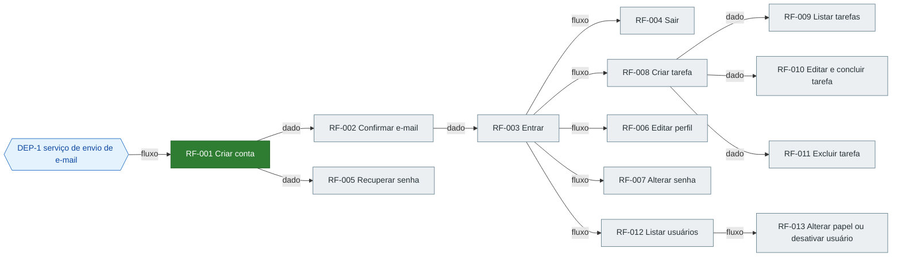

# Roadmap: Template de aplicação web com contas e tarefas

Gerado de `prd.md` versão 0.1.0 pela skill prd-writer. Status se muda na coluna Status da tabela de ondas (pendente, em andamento, feito, bloqueado, removido; bloqueado exige motivo em Observação). Grafo, ondas e situação são regenerados a partir dos blocos 'Depende de' de cada RF no PRD; para mudar uma dependência, mude o PRD.

## Situação

- Concluídos: 1 de 13 RFs (8 por cento)
- Onda atual: 2
- Liberados para começar: RF-002, RF-005
- Em andamento: nenhum
- Bloqueados: nenhum
- Caminho crítico restante: RF-002 → RF-003 → RF-008 → RF-009 (4 RFs)

## Grafo

Aresta A → B: B não pode ser construído ou validado sem A.

Legenda: cinza pendente, amarelo em andamento, verde feito, vermelho bloqueado, azul dependência externa.

## Ondas

RFs da mesma onda podem ser desenvolvidos em paralelo.

| Onda | RF | Nome | Prioridade | Status | Observação | Depende de |
| --- | --- | --- | --- | --- | --- | --- |
| 1 | RF-001 | Criar conta | alta | feito | avaliação limpa em docs/features/RF-001-criar-conta/avaliacao.md | DEP-1 |
| 2 | RF-002 | Confirmar e-mail | alta | pendente |  | RF-001 |
| 2 | RF-005 | Recuperar senha | media | pendente |  | RF-001 |
| 3 | RF-003 | Entrar | alta | pendente |  | RF-002 |
| 4 | RF-004 | Sair | alta | pendente |  | RF-003 |
| 4 | RF-008 | Criar tarefa | alta | pendente |  | RF-003 |
| 4 | RF-006 | Editar perfil | media | pendente |  | RF-003 |
| 4 | RF-007 | Alterar senha | media | pendente |  | RF-003 |
| 4 | RF-012 | Listar usuários | media | pendente |  | RF-003 |
| 5 | RF-009 | Listar tarefas | alta | pendente |  | RF-008 |
| 5 | RF-010 | Editar e concluir tarefa | alta | pendente |  | RF-008 |
| 5 | RF-011 | Excluir tarefa | alta | pendente |  | RF-008 |
| 5 | RF-013 | Alterar papel ou desativar usuário | media | pendente |  | RF-012 |

Dependências externas no grafo
- DEP-1 serviço de envio de e-mail
